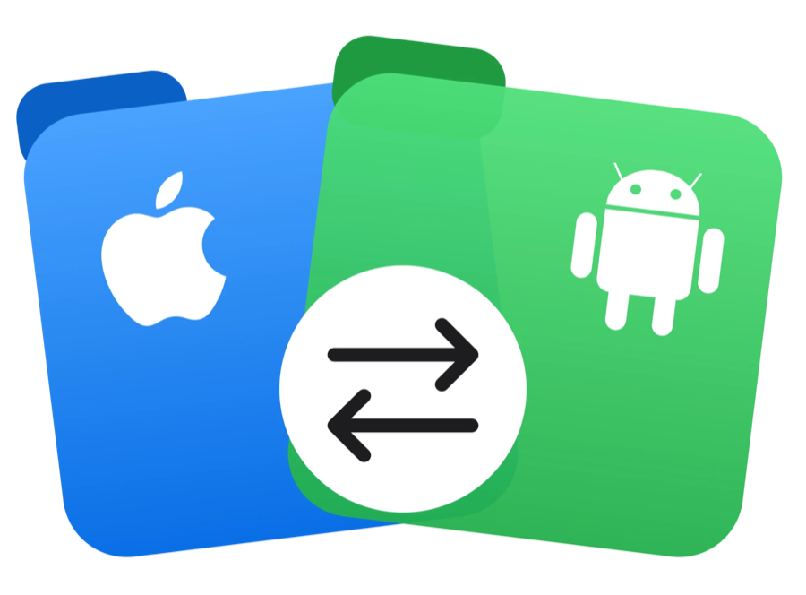

<div align="center">



# **Android Repo Manager**

**A native macOS app for managing files on Android devices.**

</div>

---

Android Repo Manager is a SwiftUI app for macOS that lets you browse, copy, move, and delete files on an Android phone or tablet directly from the Mac — no Android File Transfer, no cables-and-prayers. It talks to devices over **ADB**, **MTP (USB File Transfer)**, and mounted **SD cards**, all through one consistent file browser.

## Features

- **Full file browser** — `NavigationSplitView` sidebar, sortable list/grid views, breadcrumbs, search, and an inspector panel, built around a real `Table` with multi-select.
- **Three connection types, one interface**
  - **ADB** (USB debugging or Wireless debugging) — shells out to the `adb` you already have installed.
  - **MTP** (USB, "File Transfer" mode) — talks to the device directly via `libmtp`, the same way Android File Transfer does, with no bundled CLI tools involved.
  - **SD cards** — plain `FileManager` access to mounted/removable volumes, detected automatically on insert.
- **Drag and drop, both directions** — drag files from Finder straight into a device folder, or drag files out of the device browser into Finder.
- **Real transfer progress and cancellation** — pushes and pulls report live progress per backend (a libmtp callback for MTP, chunked copy for SD), and cancelling a transfer actually stops the operation in flight instead of just hiding it.
- **Storage & Backup** screen — see used/free space by category and back up chosen folders to the Mac.
- **Automatic device detection** — SD cards via `NSWorkspace` mount notifications, MTP devices via IOKit USB hotplug watching (with a polling fallback for devices that switch USB mode without a full re-plug).

## Requirements

- macOS 26 or later
- Xcode 16+ (uses `PBXFileSystemSynchronizedRootGroup` — Xcode auto-discovers project files from disk)
- [`adb`](https://developer.android.com/tools/adb) on your `$PATH` or at `/opt/homebrew/bin/adb` (configurable in Settings → Connections) for the ADB backend
- [`libmtp`](https://formulae.brew.sh/formula/libmtp) via Homebrew for the MTP backend:
  ```bash
  brew install libmtp
  ```

## Building

Open `AndroidRepoManager.xcodeproj` in Xcode and run. The app ships with **App Sandbox disabled** — `Process`-based ADB calls and direct `libmtp`/USB access aren't compatible with the sandbox, which also means it isn't currently Mac App Store–eligible.

## Architecture

Every connection type implements a single `DeviceFileSystem` protocol (`list`, `pull`, `push`, `delete`, `makeDirectory`, …), so the UI and `AppState` never know which backend they're talking to — swapping or adding a backend doesn't touch the file browser.

```
AndroidRepoManager/
├── Backends/     ADBFileSystem, MTPFileSystem, VolumeFileSystem, DeviceFileSystem protocol
├── Models/       Device, FileNode, Transfer
├── State/        AppState (+Actions, +RemovableVolumes, +MTPHotplug), TransferQueue
├── Views/        Browser, Sidebar, Inspector, Onboarding, Storage, Transfers, Settings
└── Support/      Drag-and-drop, formatting, file-kind helpers
```

This was built in deliberate phases: UI with sample data first, then ADB, then SD cards, then MTP last — each backend validated against real hardware before moving to the next.

## License

No license has been chosen yet for this project.
